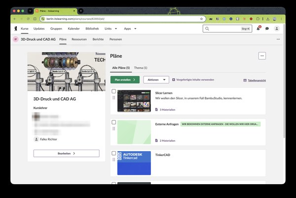

Die [3D-Druck AG am Rosalind-Franklin-Gymnasium]({{ '/projekte/3d-druck-ag-rosalind-franklin-gymnasium/' | relative_url }}) organisiert sich über **itslearning**, die Lernplattform der Berliner Schulen. Dort hat die „3D-Druck und CAD AG“ einen eigenen Kurs, in dem die Kursleitung – Falko ist auch dabei – die Themen als **Pläne** mit Materialien anlegt:

- **Slicer lernen** – wir lernen den Slicer kennen, in unserem Fall BambuStudio.
- **TinkerCAD** – Konstruieren im Browser.
- **Externe Anfragen** – wir bekommen Anfragen von außen und organisieren sie hier.

So haben alle Kinder die Materialien an einem Ort und können auch zu Hause weitermachen.

  

