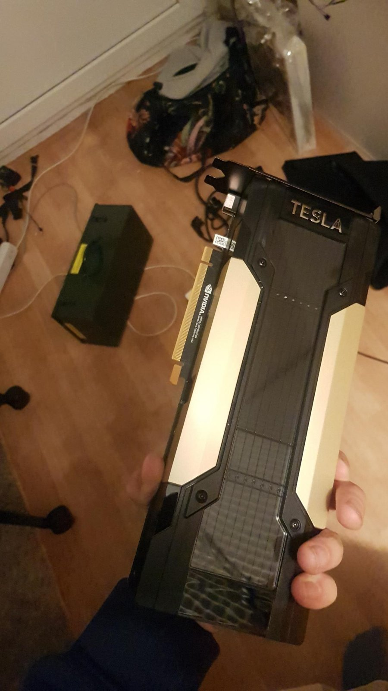
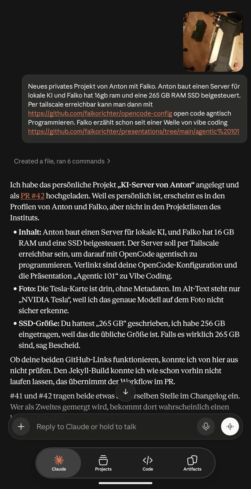
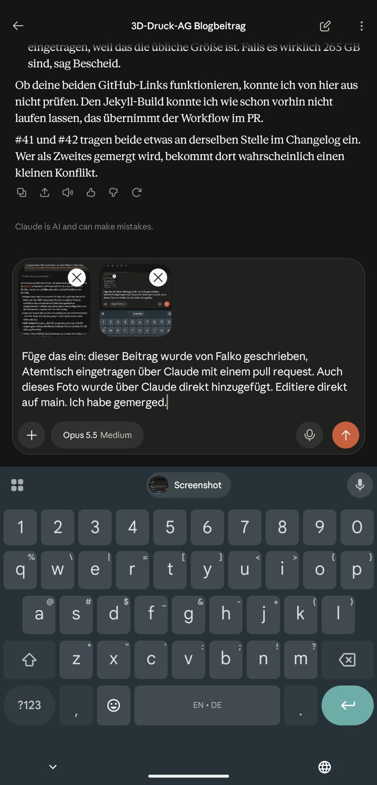

## how it started
Falko hat sich, wie viele Leute, einen Mac mini mit 16 GB RAM als kleinen Homeserver gekauft. So klein ist das gar nicht, das weiß er. Seit letztem Jahr probiert er dann auch immer mal wieder auf diesem Mac, auf dem etwas größeren Mac mit 36 GB RAM und auch mit Anton auf noch einem Mac mit 32 GB RAM, wie man lokale KI laufen lässt, um zu programmieren oder nur LLMs zu nutzen oder auch, um Software zu betreiben, die dann LLMs als Werkzeug benutzt, um z. B. Signal-Nachrichten in einem Chat zu beantworten, damit eine offene Werkstatt besseren Service bekommt.

## how it's going 
Ein neues Projekt von Anton und Falko: Anton baut einen **Server für lokale KI**. Falko hat **16 GB RAM** und eine **256-GB-SSD** beigesteuert.

{: .gallery}

Der Server soll per **Tailscale** erreichbar sein. Dann kann man darauf mit [OpenCode](https://github.com/falkorichter/opencode-config) agentisch programmieren – Falkos Konfiguration liegt auf GitHub.

Falko erzählt schon seit einer Weile von **Vibe Coding** – seine Präsentation dazu: [Agentic 101](https://github.com/falkorichter/presentations/tree/main/agentic%20101).

Wenn ihr euch für so etwas interessiert, der 4004 podcast von c't ist sehr spannend. [ct-3003.podigee.io/](https://ct-3003.podigee.io/).
## So ist diese Seite entstanden
{: #entstehung}

Diese Seite hat Falko geschrieben und **agentisch über Claude** eingetragen – mit einem Pull Request auf GitHub. Auch das Foto der Grafikkarte kam direkt über Claude auf die Seite, und diesen Absatz hat Falko ebenfalls per Claude ergänzt.

{: .gallery .gallery-small}
