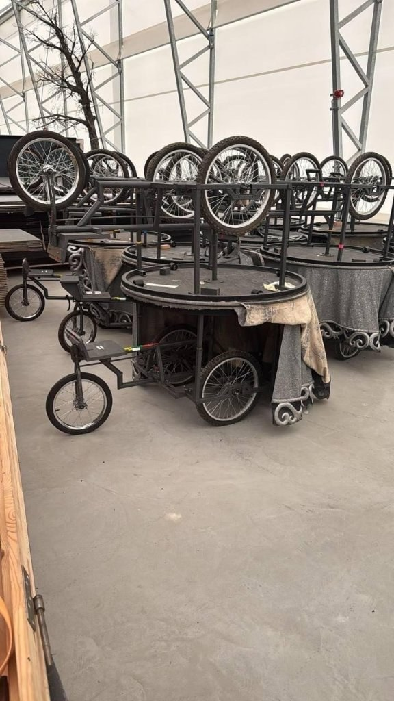

Über [35services e. V.]({{ '/partner/35services/' | relative_url }}) haben wir eine Anfrage bekommen: In einem Theater stehen mehrere dreirädrige Bühnenwagen, die abgegeben werden. Die Idee: Wir holen die Teile ab und bauen sie gemeinsam mit dem **Lastenrad-Netzwerk in Berlin** zu tollen **Lastenanhängern** aus.

Auf dem Foto stehen die Wagen in einer Lagerhalle: geschweißte Stahlrahmen auf Fahrradrädern mit kleinem gelenkten Vorderrad, runder Tischplattform und Bühnenverkleidung – jeweils ein zweites Gestell kopfüber darauf gestapelt.

{: .gallery}
