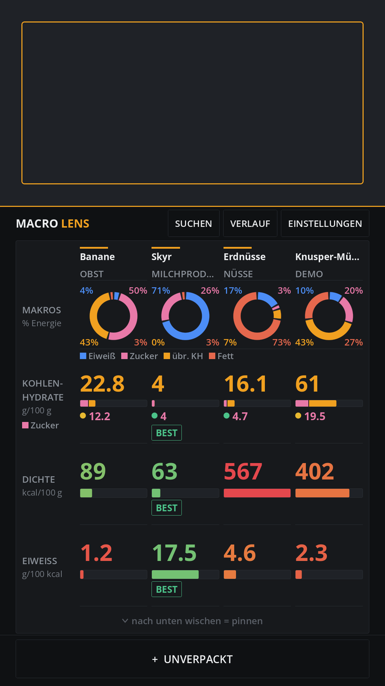
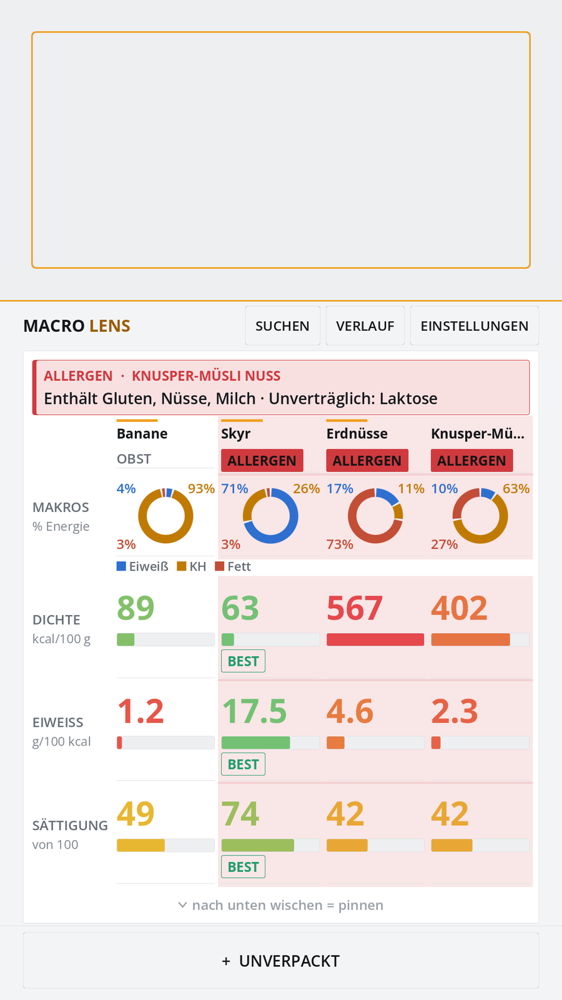
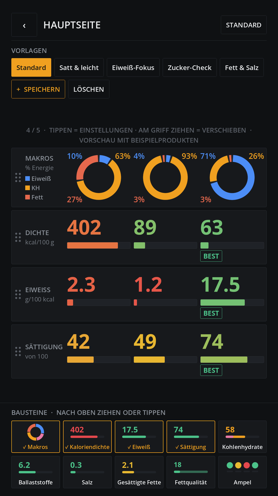

Im Supermarkt steht man vor einem Regal und hat drei Sekunden. Was auf der Rückseite steht, ist in dieser Zeit nicht zu lesen – und die Zahlen sagen ohnehin wenig, wenn man sie nicht einordnen kann.

**Macro-Lens** macht daraus einen Vergleich: Kamera auf den Barcode, und die App zeigt vier Dinge, die eine Entscheidung tragen.

{: .gallery}

## Die vier Grafiken

- **Makro-Donut** – wie sich die Energie auf Eiweiß, Fett und Kohlenhydrate verteilt
- **Kaloriendichte** – kcal pro 100 g
- **Eiweißdichte** – Gramm Protein pro 100 kcal
- **Sättigung** – ein Fullness-Faktor, der Ballaststoffe und Eiweiß positiv und Zucker negativ gewichtet

Dazu kommen Zucker, Salz, gesättigte Fette, Ballaststoffe und eine Ampel nach den FSA-Schwellen. Welche Bausteine man sieht, entscheidet man selbst: bis zu fünf von zehn, frei zusammenstellbar.

## Allergene

Der Teil, der am meisten gebracht hat: Man stellt einmal ein, was man nicht verträgt – die 14 EU-Allergene, dazu Laktose, Fruktose, Sorbit, Koffein und Histamin – und die App warnt beim Scan. Rot und dreifache Vibration bei einer Allergie, orange bei Unverträglichkeit oder Spuren. Fehlen die Zutaten eines Produkts, sagt sie „nicht geprüft" und nicht „sicher".

{: .gallery}

## Was die App bewusst nicht macht

Keine Mengen, kein Tracking, keine Tagebuchfunktion, keine Note und kein Buchstabe. Ein Messgerät, kein Ernährungsberater. Dazu: **keine Konten, keine Cloud, keine Werbung, keine Telemetrie.** Die Allergenauswahl bleibt auf dem Gerät, weil sie ein Gesundheitsdatum ist. Die Nährwerte kommen aus Open Food Facts, die Erkennung läuft mit ML Kit direkt auf dem Telefon.

## Stand

Seit Oktober 2026 im **Google Play Store**, Quelltext offen unter **[3p1cball-code/macro-lens](https://github.com/3p1cball-code/macro-lens)** (MIT). Geschrieben in Godot mit einem eigenen CameraX-Plugin, damit die Kamera läuft, ohne dass die App den Play-Dienst zum Scannen braucht.

{: .gallery}
