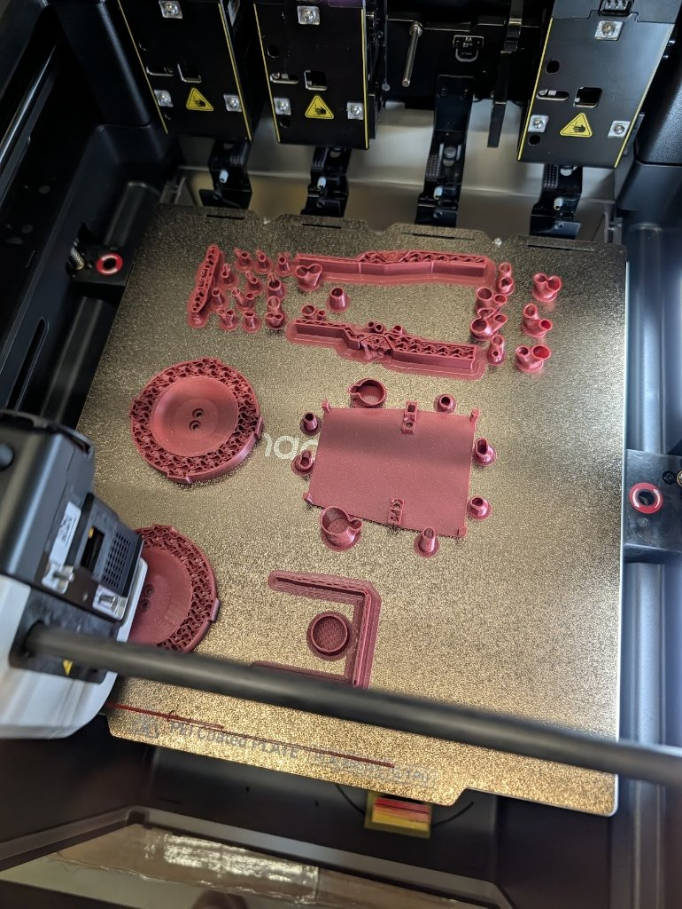

# Der vorläufige Plan:

Ergänzend zur ehrenamtlichen [3D-Druck AG an der KTG]({{ '/projects/3d-druck-ag-ktg/' | relative_url }}) startet [Falko]({{ '/team/falko-richter/' | relative_url }}) als privates Projekt eine **Modellbau-AG an der [Kurt-Tucholsky-Grundschule]({{ '/partners/' | relative_url }}#kurt-tucholsky-grundschule) (KTG)**: Für **40 Euro im Monat pro Kind** (für Filament, Elektronik, Motoren, Kleinteile und Druckzeit) bauen die Kinder Schritt für Schritt ihre eigenen **3D-gedruckten ferngesteuerten Fahrzeuge**. Es gibt 16 Euro Rabatt, wenn ihr selber einen Drucker oder Zugang zu einem Drucker habt. Ihr wollt dann ja auch selber drucken.

Gedruckt wird unter anderem auf dem [Snapmaker U1 an der KTG]({{ '/equipment/snapmaker-u1/' | relative_url }}) und im Keller auf [Falkos privatem Snapmaker U1]({{ '/equipment/snapmaker-u1-falko/' | relative_url }}), sodass auch größere Bausätze, mehrfarbige Karosserieteile und flexible Reifen aus TPU oder NinjaFlex (zum Beispiel auf dem [LulzBot Mini]({{ '/equipment/lulzbot-mini/' | relative_url }})) zuverlässig entstehen.

{: .gallery}

## Inspiration aus unseren Projekt-Ideen und aus dem Team

Was genau gebaut wird, schöpft aus unserer Sammlung unter **[Projekt-Ideen – Ferngesteuerte Fahrzeuge]({{ '/project/ideas/' | relative_url }}#ferngesteuerte-fahrzeuge)** und den laufenden RC-Projekten im Team:

- **Traktoren & Landmaschinen:** Der **[RC Tractor von ProfessorBoots]({{ '/projects/rc-tractor-professorboots/' | relative_url }})**, den [Falko]({{ '/team/falko-richter/' | relative_url }}) und [Opa Andi]({{ '/team/opa-andi/' | relative_url }}) gerade gemeinsam drucken (mit modifizierter Motorhaube und flexiblen Reifen), oder der von Opa Andi empfohlene **[OpenRC Tractor](https://www.printables.com/model/318896-openrc-tractor-mk3-tea20)**.
- **Bagger, Kipplaster & Baustelle:** Bereits im [ersten Jahr der KTG-AG (2023/24)]({{ '/projects/ktg-ag-jahr-1/' | relative_url }}) haben Kinder erfolgreich den **[RC Skid Steer V2.0](https://www.printables.com/model/544937-v20-3d-printed-rc-skidsteer)** (Mini-Bagger mit TPU-Ketten) und den passenden **[RC Dump Truck](https://www.printables.com/model/649741-v20-3d-printed-rc-dumptruck)** gebaut.
- **Geländewagen, Crawler & Buggys:** Im Team entstehen mit dem **[3DSets Mogster 4x4 Tipper]({{ '/projects/3dsets-mogster-bauen/' | relative_url }})** von [Falko]({{ '/team/falko-richter/' | relative_url }}), [Opa Andi]({{ '/team/opa-andi/' | relative_url }}) und [Anton]({{ '/team/anton/' | relative_url }}) ausgewachsene 1:8-Geländefahrzeuge mit Portalachsen und Kippmulde. Für die AG bieten sich außerdem kompaktere Modelle aus unserer [Ideenliste]({{ '/project/ideas/' | relative_url }}) an – vom **4x4 Mini-RC-Crawler** über ein **Print-in-Place-RC-Auto** bis hin zur Projektidee **[Tarmo5]({{ '/projects/tarmo5/' | relative_url }})**.

## Elektronik: Von N20-Motoren bis CyberBrick

Für das Innenleben der Fahrzeuge kombinieren wir bewährte Bastel-Elektronik mit neuen Baukastensystemen:

- **CyberBrick von Bambu Lab:** Als spannende Inspiration für die Elektronik dient das modulare Plug-and-Play-Ökosystem **CyberBrick**, mit dem sich 3D-gedruckte Modelle ohne kompliziertes Löten mit Empfängern, Motoren, Servos, LEDs und einem ebenfalls 3D-gedruckten Controller ausstatten lassen – vorgestellt im Video **[„Schluss mit DEKO & FLEXIDRACHEN! DAS ist Cyberbrick von Bambu Lab“ (mpoxDE auf YouTube)](https://www.youtube.com/watch?v=haND18lduJ4)**.
- **Klassische RC- & Mikrocontroller-Elektronik:** Je nach Modell und Altersstufe kommen auch klassische **N20-Getriebemotoren**, **DRV8833-Motortreiber**, Standard-Servos und selbst gelötete Schaltungen zum Einsatz, wie wir sie schon im [ersten AG-Jahr]({{ '/projects/ktg-ag-jahr-1/' | relative_url }}) genutzt haben.

[Weitere Details folgen – genaue Termine, Anmeldung, Aufteilung der 40 € Materialbudget und welche Fahrzeugmodelle wir als Erstes bauen.]
