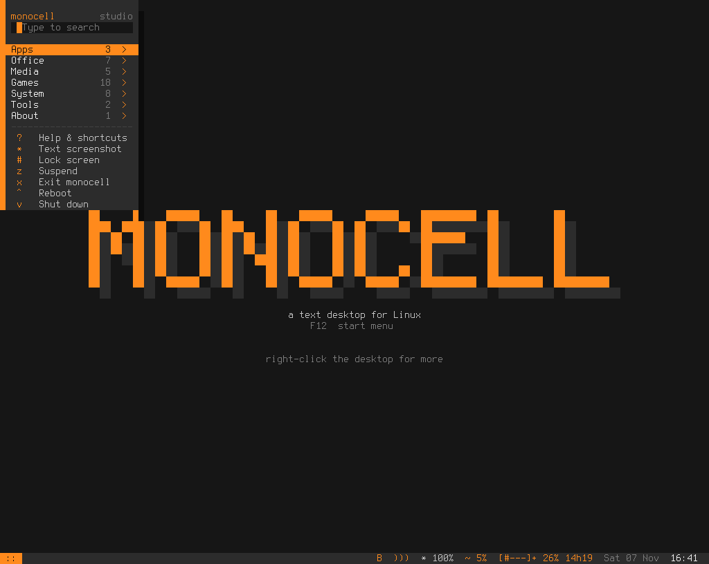
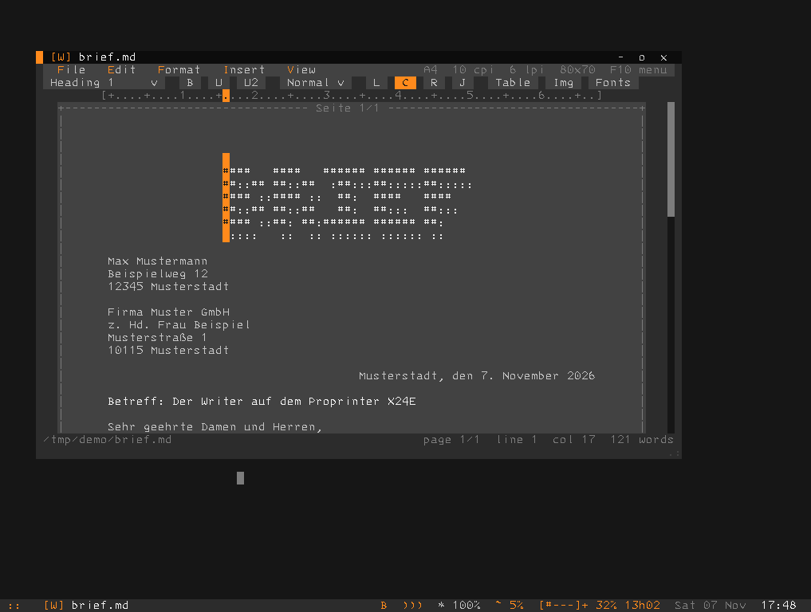
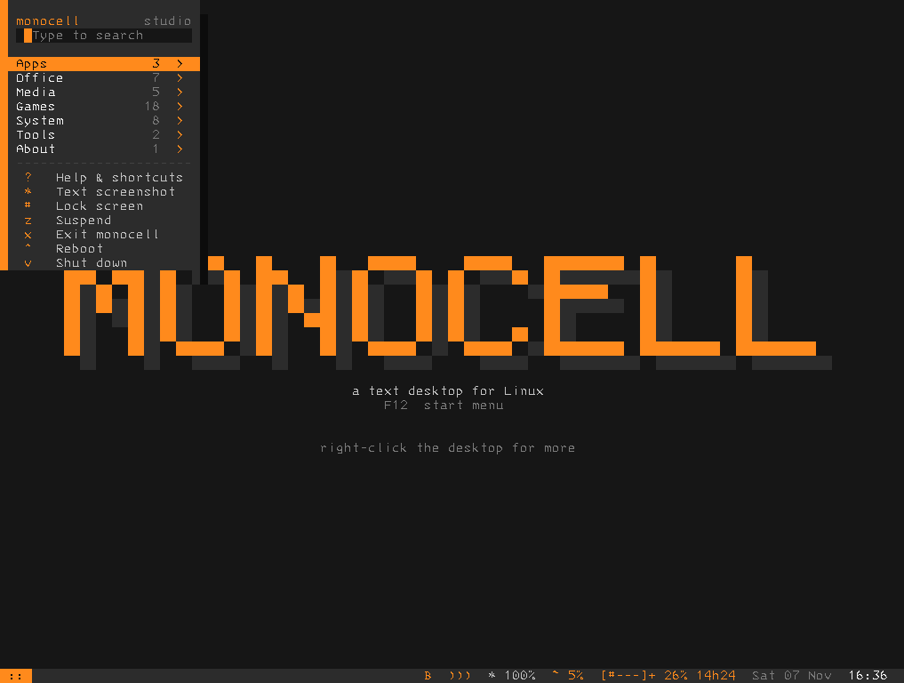

Monocell ist ein Desktop, der komplett aus Textzeichen besteht – und dabei alles hat, was man zum Arbeiten braucht: überlappende Fenster, eine Taskleiste, ein Startmenü mit Kategorien, Dateimanager, Editor, Tabellen, PDF-Betrachter, Bild- und Videowiedergabe, Browser, Mail, Kalender.

Der Punkt ist nicht Nostalgie allein. Der Punkt ist, dass ein Rechner mit 1 GB RAM und einer alten CPU damit wieder **benutzbar** wird, statt im Schrank zu liegen.

{: .gallery}

## Warum Text?

Weil Text unglaublich wenig kostet. Monocell braucht im Leerlauf etwa **25 MB Arbeitsspeicher** – nicht weil es sparsam wäre, sondern weil ein Zeichenraster nun einmal klein ist. Auf einem Gerät, das kein modernes Betriebssystem mehr trägt, ist das der Unterschied zwischen „geht nicht" und „geht".

Dafür wird die ganze Maschine selbst gebaut: ein eigener Zellen-Compositor mit Diff-Renderer, vier Farb-Modi (24-bit, Palette, Linux-Konsole mit acht Hintergrundslots, ANSI) und Mausunterstützung – in modernen Terminals über das SGR-Protokoll, auf der echten Konsole über `/dev/input/mice`.

## Was drin ist

- **Fenstermanager** mit Z-Order, Ziehen, Größe ändern, Andocken an Hälften und Viertel, Taskleiste, Uhranzeige, Akkustand
- **Writer** als WYSIWYG-Textverarbeitung mit Seitenansicht – und einer Druckausgabe im **PPDS-Format für Nadeldrucker**
- **Sheets** mit Formeln, CSV/XLSX/ODS und ASCII-Diagrammen
- **Browser** mit eigener Textansicht und einem Grafikmodus, in dem headless Chromium die Seite rendert und als Bild zurückschickt
- **Bilder, Video, Musik, YouTube, Maps, PDF**
- **System, Bluetooth, Netzwerk, Einstellungen** inklusive Themes, Schriftauswahl und Akkuwarnung
- **Spiele** – von Snake über JezzBall bis zu den klassischen Konsolenspielen

{: .gallery}

## Auf welcher Hardware

Entwickelt und täglich benutzt auf einem **ThinkPad X61s von 2007**: Core 2 Duo, 8 GB DDR2, 1024 × 768. Monocell startet dort direkt auf der Textkonsole, ohne X, ohne Wayland, ohne Displaymanager. Der Rechner läuft hoch, meldet sich per Fingerabdruck an und ist nach wenigen Sekunden arbeitsbereit.

{: .gallery}

## Stand

Version 1.4.1, **877 Tests**, offen auf GitHub: **[3p1cball-code/monocell](https://github.com/3p1cball-code/monocell)** (MIT). Das Projekt ist aus einem verworfenen Anlauf entstanden – erst sollte ein fertiges TUI-Setup genügen, dann wurde klar, dass es einen eigenen Desktop braucht.
