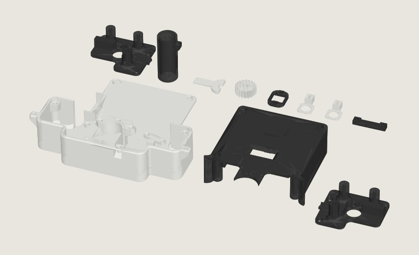
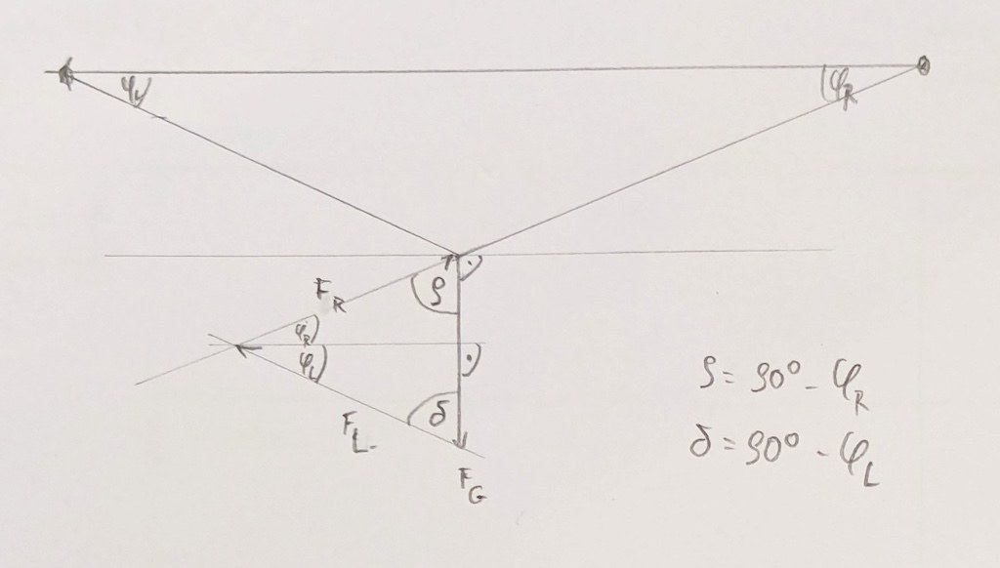

[Mural](https://getmural.me/) ist ein **Wandplotter zum Selberbauen**: Der Roboter hängt an **zwei Zahnriemen**, die oben mit Reißzwecken an der Wand befestigt sind. Zwei **Schrittmotoren** ziehen ihn über die Wand, ein kleiner Servo setzt den Stift auf und hebt ihn wieder ab – so entstehen **wandgroße Zeichnungen** mit (abwaschbaren) Filzstiften. Gesteuert wird alles über den Browser. Gerade ist **Mural V2** erschienen.

{: .gallery}

**Warum für uns?** Wir können **endlich mal Schrittmotoren verwerten**. Mural braucht zwei NEMA-17-Motoren (im Original flache „Pancake“-Motoren), dazu einen ESP32-Controller mit FluidNC, Riemen, Pulleys und ein paar Schrauben. Das Gehäuse wird **3D-gedruckt**. Wie beim [AxiDraw]({{ '/ausstattung/axidraw-v3/' | relative_url }}) sieht man beim Plotten genau, wie ein Gerät mit Motoren und Koordinaten zeichnet – nur eben an der Wand und richtig groß.

Die Idee kommt von Falko und Anton und soll bei 35services gebaut werden.

[Welche Schrittmotoren haben wir da, passen sie? Controller bestellen? – Details folgen.]

### Quellen

- Video: [Mural V2 – Open source low cost wall plotter](https://www.youtube.com/watch?v=Hjp9P1Shx5E) (YouTube)
- Projektseite mit Bauanleitung: [getmural.me](https://getmural.me/)
- Code, Druckdateien und Doku: [nikivanov/mural auf GitHub](https://github.com/nikivanov/mural) – Teileliste in [BOM.md](https://github.com/nikivanov/mural/blob/main/BOM.md), Skizze aus [KinematicModel.md](https://github.com/nikivanov/mural/blob/main/KinematicModel.md)
- Bericht: [Mural: The Plotter That Draws On Walls](https://hackaday.com/2025/03/24/mural-the-plotter-that-draws-on-walls) (Hackaday)

**Bilder:** Mural von Nik Ivanov und Mitwirkenden, [CC BY-NC 4.0](https://creativecommons.org/licenses/by-nc/4.0/deed.de). Das erste Bild haben wir aus den 3MF-Druckdateien des Repos gerendert, die Skizze stammt unverändert aus der Dokumentation.
