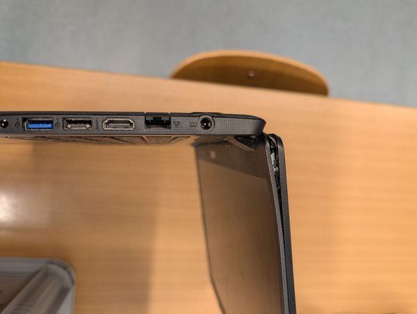

Ein neues Projekt von Falko für die [3D-Druck AG an der KTG]({{ '/projekte/3d-druck-ag-ktg/' | relative_url }}): ein **Notebook der KTG wiederbeleben**. Das **Displayscharnier hat eine Macke** – das Notebook sollte aber noch nutzbar sein, zumindest **stationär** auf dem Tisch.

Wie bei den [iPad-Stiften]({{ '/projekte/ipad-stifte-wiederbeleben/' | relative_url }}) gilt: Was an der Schule herumliegt und noch funktioniert, soll wieder genutzt werden.

  

