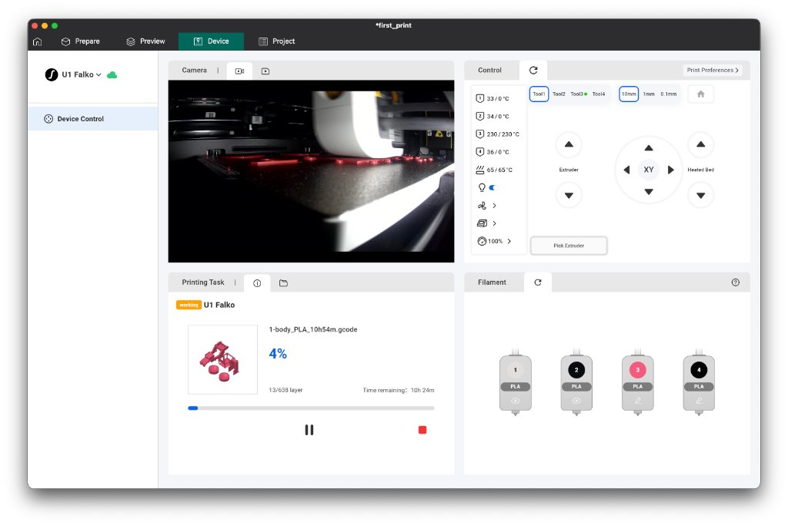
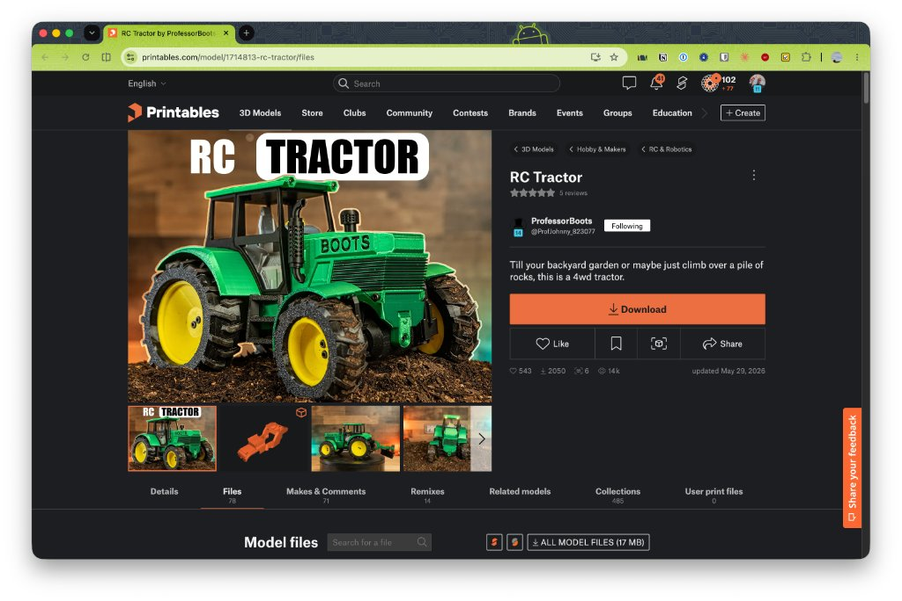
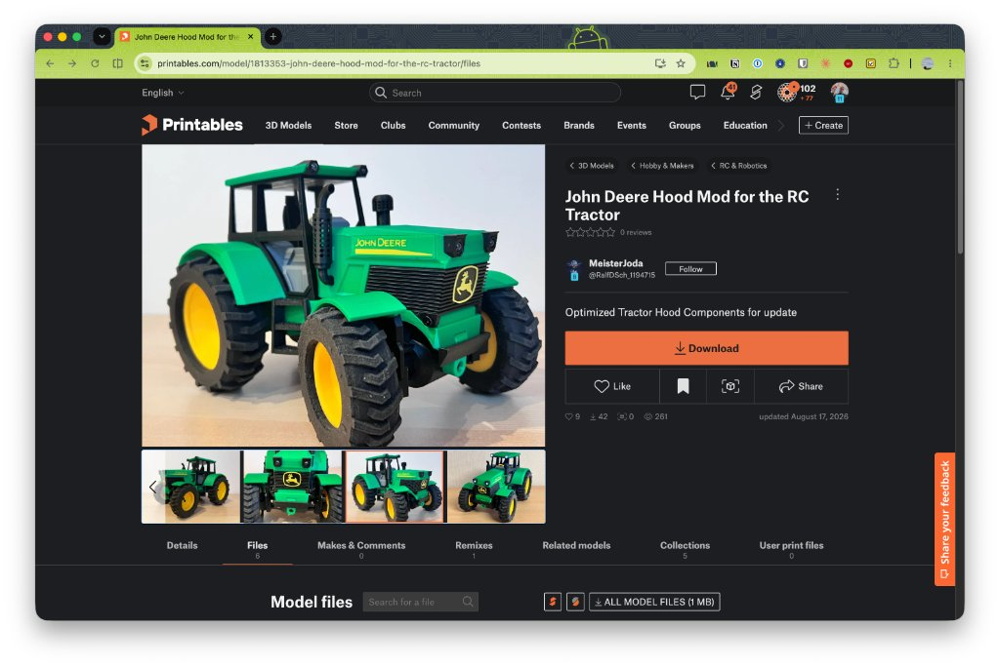

Falko und [Opa Andi]({{ '/team/opa-andi/' | relative_url }}) bauen gemeinsam für **#septembersister** einen ferngesteuerten Traktor aus dem 3D-Drucker: den **[RC Tractor](https://www.printables.com/model/1714813-rc-tractor)** von **[ProfessorBoots](https://www.printables.com/@ProfJohnny_823077)**.

Am Starttag haben wir das Filament ausgesucht und auf [Falkos Snapmaker U1]({{ '/equipment/snapmaker-u1-falko/' | relative_url }}) direkt den ersten großen Druck (`1-body_PLA`) gestartet. Um weitere Teile kümmert sich [Opa Andi]({{ '/team/opa-andi/' | relative_url }}).

## Geplante Anpassungen

- **Andere Motorhaube:** Wir drucken gleich die modifizierte Haube **[John Deere Hood Mod for the RC Tractor](https://www.printables.com/model/1813353-john-deere-hood-mod-for-the-rc-tractor/files)** von [MeisterJoda](https://www.printables.com/@RalfDSch_1194715). Da soll irgendwann der **Name** draufstehen und vorne ein **Panda-Logo** draufkommen.
- **Reifen aus NinjaFlex:** Die Reifen wird Falko auf dem **[LulzBot Mini]({{ '/equipment/lulzbot-mini/' | relative_url }})** in flexiblem **NinjaFlex** versuchen.

{: .gallery}
