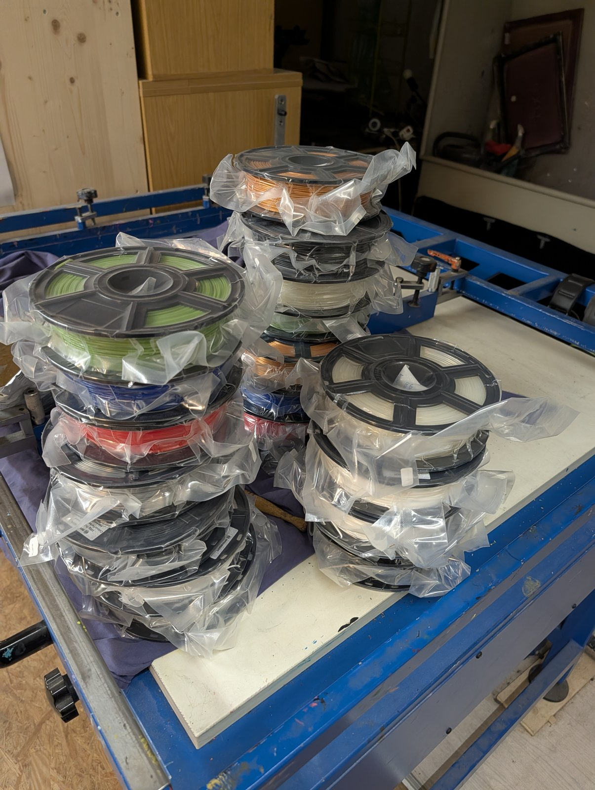

[35services e.V.](https://35services.de/) ist eine Nachbarschaftswerkstatt in Moabit und Mitglied im Verbund Offener Werkstätten. Der Verein unterstützt die [3D-Druck AG an der KTG]({{ '/projekte/3d-druck-ag-ktg/' | relative_url }}) bei der Organisation, und viele Geräte aus unserer [Ausstattung]({{ '/ausstattung/' | relative_url }}) gehören dem Verein.

## Offene Repositories {#repositories}

Unsere Konstruktionen, Druckdateien, Werkstatt-Infrastruktur und Notizen dokumentiert der Verein offen auf GitHub unter [github.com/35services](https://github.com/35services). Eine Auswahl:

### 3D-Druck & Plotter

- **[3D-Druck in der Werkstatt (`35services/3d`)]({{ '/projekte/35services-3d/' | relative_url }})** – Ersatzteile und Absaugadapter für Maschinen, Gridfinity/openGrid, Druckplatten für die Schul-AG und Mehrfarbdruck ([GitHub](https://github.com/35services/3d))
- **[2D-Projekte mit dem Stiftplotter (`35services/2d`)]({{ '/projekte/35services-2d/' | relative_url }})** – Zeichnungen, Gutscheine und Trophäen mit dem [AxiDraw V3]({{ '/ausstattung/axidraw-v3/' | relative_url }}), z. B. die [Mona Lisa]({{ '/news/2024/04/19/der-axidraw-malt-die-mona-lisa/' | relative_url }}) ([GitHub](https://github.com/35services/2d))
- **[`fabmaker-rettung`](https://github.com/35services/fabmaker-rettung)** – Wir wollen einen alten Fabmaker-Drucker wieder zum Leben bringen: Notizen, Slicer und Wartungsprogramme
- **[`prusaslicer-lulzbot-taz`](https://github.com/35services/prusaslicer-lulzbot-taz)** – PrusaSlicer-Profile für LulzBot-TAZ-Drucker wie unseren [LulzBot TAZ 6]({{ '/ausstattung/lulzbot-taz-6/' | relative_url }}) (Fork)

### Gemeinsam drucken: Infrastruktur auf dem Raspberry Pi

Wie das zusammenspielt, steht im Beitrag [3D-Druck für unsere offene Werkstatt]({{ '/news/2026/09/24/3d-druck-fuer-unsere-offene-werkstatt/' | relative_url }}).

- **[`3d-printing-proxy`](https://github.com/35services/3d-printing-proxy)** – Startseite „Drucken bei 35services“ mit Webcams, Stromverbrauch der Drucker und Weiterleitung zu allen Diensten
- **[`3d-printing-octoprint`](https://github.com/35services/3d-printing-octoprint)** – unser OctoPrint-Setup für die Prusa MK3 und MK4, mit Plugins und Slicer-Profilen
- **[`3d-printing-simple-filament-tool`](https://github.com/35services/3d-printing-simple-filament-tool)** – einfache Filamentverwaltung in PHP, ganz ohne Datenbank: welche Rolle steckt in welchem Drucker, wem gehört sie?
- **[`3d-bitwarden`](https://github.com/35services/3d-bitwarden)** – selbst gehosteter Passwortmanager (Vaultwarden) für die Werkstatt, über dieselbe Proxy-Einrichtung erreichbar

### Für die 3D-Druck AG, die Schule und Jugend hackt

- **[3D-Druck-Stick (`3ddruck-jugend-hackt-iso`)]({{ '/projekte/3ddruck-iso-jugend-hackt/' | relative_url }})** – Linux-Live-System auf USB-Stick für CAD und 3D-Druck, aufbauend auf dem Image von [Jugend hackt]({{ '/partner/jugend-hackt/' | relative_url }}); läuft auf den [Laptops der AG]({{ '/ausstattung/laptops-druck-sticks/' | relative_url }}) ([GitHub](https://github.com/35services/3ddruck-jugend-hackt-iso))
- **[`3ddruck-geteilter-ordner`](https://github.com/35services/3ddruck-geteilter-ordner)** – ein „Geteilter Ordner“ auf allen Rechnern der AG, per Syncthing abgeglichen, mit Signal-Nachricht bei Änderungen
- **[Programmierwerkstatt (`programmierwerkstatt`)]({{ '/projekte/programmierwerkstatt-lessing-gymnasium/' | relative_url }})** – Ablauf und Hinweise für eine Scratch-Programmierwerkstatt mit Schüler*innen ([GitHub](https://github.com/35services/programmierwerkstatt))

### Werkstatt & Verein

- **[`fabacess-doku`](https://github.com/35services/fabacess-doku)** – unser FabAccess-Setup: Zugangssystem für offene Werkstätten, gefördert vom Verbund Offener Werkstätten
- **[`drehbank-einweisung_35Services`](https://github.com/35services/drehbank-einweisung_35Services)** – Einweisung in die Drehbank, angepasst auf 35services (auf Basis der Einweisung des FAU FabLab, dessen Original als [Fork](https://github.com/35services/drehbank-einweisung) daneben liegt)
- **[`carla-cargo-crowd`](https://github.com/35services/carla-cargo-crowd)** – Notizen zur Säge (Einstellungen, Kühlflüssigkeit, Ordnung an der Maschine)
- **[`hygiene`](https://github.com/35services/hygiene)** – Linksammlung zur Lebensmittelhygiene-Belehrung nach Infektionsschutzgesetz
- **[`subtitles`](https://github.com/35services/subtitles)** – Untertitel für Videos, z. B. vom Tag der offenen Tür 2021

### Werkzeuge & Web

- **[`minibikefest-vote`](https://github.com/35services/minibikefest-vote)** – kleine PHP-Abstimmungsseite „Best Bike of Show“ für das Minibikefest
- **[`slack-2-wordpress`](https://github.com/35services/slack-2-wordpress)** – macht aus Slack-Threads WordPress-Beiträge
- **[`html`](https://github.com/35services/html)** – HTML-Schnipsel, z. B. ein Spenden-Dialog für betterplace
- **[`calendar-stats`](https://github.com/35services/calendar-stats)** – Statistiken aus Google-Kalendern (Fork)

## Filamentspende

Im Oktober 2026 gab es Nachschub: ein ganzer Tisch voller Filamentrollen in vielen Farben.

{: .gallery}

→ [35services.de](https://35services.de/)



<a href="{{ '/partner/' | relative_url }}" class="back-link">← Alle Partner</a>
