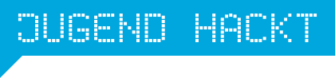

[Jugend hackt](https://jugendhackt.org/) ist ein Programm für junge Menschen, die mit Code die Welt verbessern wollen – seit über zehn Jahren, mit Events in ganz Deutschland, Österreich und der Schweiz.

## Was wir gemeinsam machen

- **Der 3D-Druck-Stick:** Jugend hackt hat ein Linux-Live-System für USB-Sticks gebaut, mit dem auf ihren Veranstaltungen gearbeitet wird. Darauf baut Falko den [3D-Druck-Stick]({{ '/projekte/3ddruck-iso-jugend-hackt/' | relative_url }}) für unsere AGs auf – offen, zum Nachmachen.
- **Jugend Hackt Congress 2026:** 35services hat den Congress mit Hardware und Freiwilligen unterstützt – mit LulzBot-Druckern und dem AxiDraw. → [Bericht vom Congress]({{ '/news/2026/10/19/jugend-hackt-congress-2026/' | relative_url }})

→ [jugendhackt.org](https://jugendhackt.org/)




<a href="{{ '/partner/' | relative_url }}" class="back-link">← Alle Partner</a>
