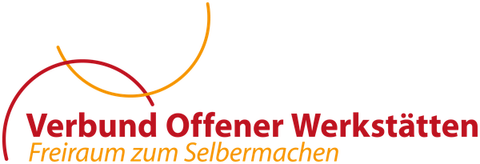

Der **[Verbund Offener Werkstätten e. V.](https://offene-werkstaetten.org/de)** ist der Dachverband und das Netzwerk der offenen Werkstätten in Deutschland – die Interessenvertretung von mehr als 500 Mitgliedswerkstätten. Gegründet wurde der gemeinnützige Verein 2012 aus der Community heraus, sein Sitz ist in Berlin.

Offene Werkstätten teilen Wissen, Werkzeuge und Maschinen, Technik und Materialien. Der Verbund stärkt sie durch Vernetzung, Austausch und fachliche Beratung, mit Netzwerktreffen, gegenseitigen Projektbesuchen und Weiterbildungen, und regt zum Selbermachen an.

## Was uns verbindet

- **35services ist Mitglied:** Unsere Partnerwerkstatt [35services e. V.]({{ '/partners/35services/' | relative_url }}) in Moabit gehört zum Verbund.
- **FabAccess:** Das Zugangssystem für offene Werkstätten, das 35services einsetzt, wird vom Verbund gefördert – die Einrichtung ist in [`fabacess-doku`](https://github.com/35services/fabacess-doku) dokumentiert.
- **Das Aussehen dieser Seite:** Sie erscheint im Theme „Offene Werkstätten“, angelehnt an den Stil von [offene-werkstaetten.org](https://offene-werkstaetten.org/de). Unten auf der Seite lässt sich das Aussehen umstellen.

→ [offene-werkstaetten.org](https://offene-werkstaetten.org/de) · [Werkstatt in der Nähe finden](https://www.offene-werkstaetten.org/de/werkstatt-suche)



<a href="{{ '/partners/' | relative_url }}" class="back-link">← Alle Partner</a>
