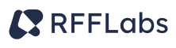

**[RFFLabs – Réseau Français des FabLabs, Espaces et Communautés du Faire](https://www.rfflabs.fr/)** ist das französische Netzwerk der FabLabs, Makerspaces und Gemeinschaften des Selbermachens – ein landesweiter Verein, gegründet 2015. Dazu gehören bestehende Werkstätten und solche, die gerade entstehen, und die Menschen, die dort arbeiten, begleiten und bauen.

Das Netzwerk steht für Lernen durch Machen, das Recht, Fehler zu machen, offene Dokumentation, Offenheit für alle und das Weitergeben von technischem Wissen. Es arbeitet in thematischen Arbeitsgruppen, hat einen wissenschaftlichen Beirat, der Forschung und Praxis zusammenbringt, und lädt einmal im Jahr zum großen RFFLabs-Treffen ein.

## Was uns verbindet

- **Kennengelernt beim Verbund:** Bei der Jahreshauptversammlung des [Verbunds Offener Werkstätten]({{ '/partners/offene-werkstaetten/' | relative_url }}) hat [Falko]({{ '/team/falko-richter/' | relative_url }}) ganz liebe Kolleg*innen von RFFLabs aus Frankreich getroffen.
- **Die Seite des Instituts mitnutzen:** Dabei kam Interesse auf, die Seite des Instituts auch für die eigene Arbeit zu nutzen – Projekte, Herausforderungen und Geräte lassen sich hier gemeinsam sammeln.
- **Das Aussehen dieser Seite:** Sie erscheint im Theme „RFFLabs“, angelehnt an den Stil von [rfflabs.fr](https://www.rfflabs.fr/). Unten auf der Seite lässt sich das Aussehen umstellen.

→ [rfflabs.fr](https://www.rfflabs.fr/) · [Qui sommes-nous ?](https://www.rfflabs.fr/qui-sommes-nous/)



<a href="{{ '/partners/' | relative_url }}" class="back-link">← Alle Partner</a>
