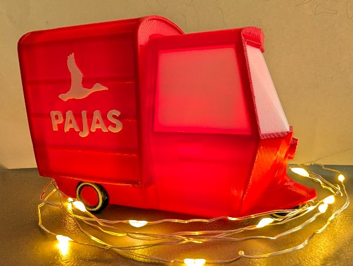

Das **[ZAZZA](https://www.pajas-kaffee.de/about-3)** ist das Nachbarschaftscafé von [PAJAS Kaffee](https://www.pajas-kaffee.de/) in Moabit: seit 2022 am **Platz der Nachbarschaft** in der Lehrter Straße, mit Kaffee, Kuchen und mittags Suppe – ein Treffpunkt für den Kiez. Mit der „Rollenden Kaffeebar“ kommt Pajas außerdem zu Veranstaltungen.

Hinter dem Zazza stehen **Paul und Zazza-Jan** (so nennen wir ihn, damit er nicht mit Jan aus unserem Team verwechselt wird). Zazza-Jan ist außerdem Mitglied bei [35services e. V.]({{ '/partners/35services/' | relative_url }}).

## Was wir gemeinsam machen

- **Unterstützung von Anfang an:** Schon beim Start der ersten [3D-Druck- und Elektronik-AG an der KTG]({{ '/news/2024/01/08/diy-eine-3d-druck-und-elektronik-ag-an-der-ktg/' | relative_url }}) 2024 gab es Kaffee und Unterstützung aus dem Zazza – und im [ersten AG-Jahr]({{ '/projects/ktg-ag-jahr-1/' | relative_url }}) war das Zazza einer der Sponsoren, die die Kinder selbst gefunden haben.
- **Moabiter Lastenlaufrad Kiez-WM:** Beim Frühlingsfest im Zazza am 9. Mai 2026 fand die erste [Lastenlaufrad-Weltmeisterschaft im Kiez]({{ '/projects/lastenlaufrad-kiez-wm-2026/' | relative_url }}) statt – für Kinder und Erwachsene.
- **Herbstfest beim Zazza:** Kastanienfiguren basteln mit [live 3D-Druck von Hüten und Stiefeln]({{ '/calendar/2026-10-10-herbstfest-beim-zazza/' | relative_url }}) direkt auf dem Platz der Nachbarschaft.
- **Winterfest in der Kulturfabrik:** Am 5. Dezember 2026 feiern wir gemeinsam das [Winterfest in der Kulturfabrik Moabit]({{ '/calendar/2026-12-05-winterfest-kulturfabrik/' | relative_url }}).

→ [pajas-kaffee.de](https://www.pajas-kaffee.de/) · [Instagram @zazza_moabit](https://www.instagram.com/zazza_moabit/)






<a href="{{ '/partners/' | relative_url }}" class="back-link">← Alle Partner</a>
